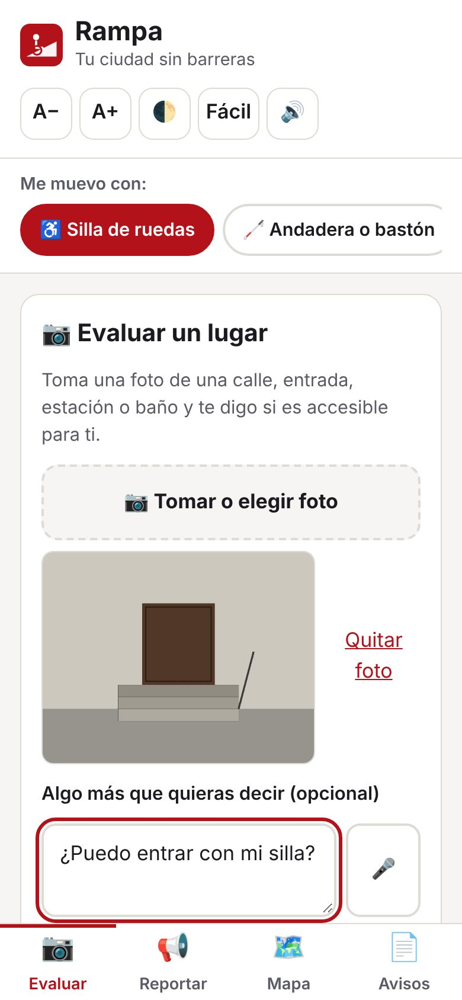
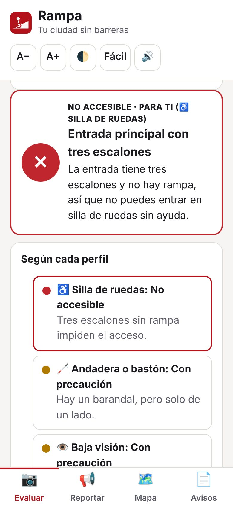
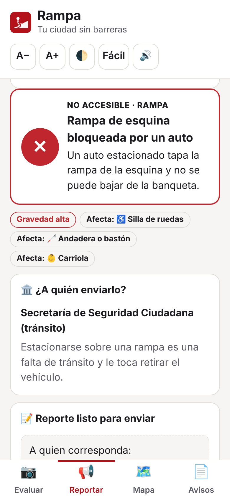
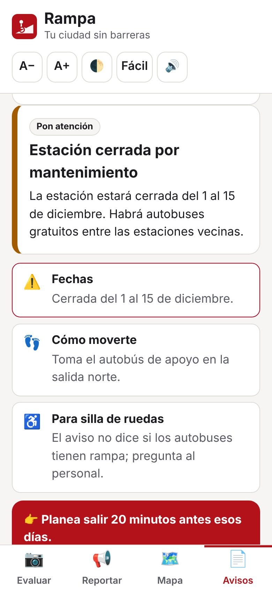
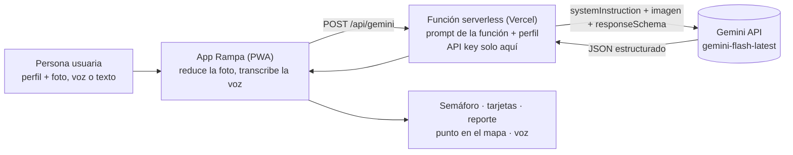

# Rampa · tu ciudad sin barreras

> **App demostrable:** **https://hackathon-uvm-2026-ym9g.vercel.app** (se abre desde el navegador del celular, no requiere instalar nada)
>
> **Video del pitch (5 min):** _se agrega en la Fase 4_
> **Boceto:** [Rampa · Boceto (Fase 2)](https://docs.google.com/document/d/1g7Ux64lyFIsfdHsQ64-1B5eRziDOzUZ0gi__UpcVCKY/edit?usp=drivesdk)
> **Documentación generada con Gemini:** [Lincecitos · Documentación con IA](https://docs.google.com/document/d/1BvXZeAwKfiy4XIri-Ww_P_gJRS4612DZWyBdQ1TVE4A/edit?usp=drivesdk) · [conversación con Gemini](https://share.gemini.google/WKxV80h3RsM2)

Hackathon Nacional de Innovación con IA · **Ingenio Incluyente** · UVM 2026
**Reto 2 · Ciudad para todas y todos** · ODS 10 y 11
**Equipo Lincecitos** · UVM Campus San Rafael/Reforma

|  |  |  |  |
|:-:|:-:|:-:|:-:|
| Perfil y foto del lugar | Semáforo por perfil | Reporte listo para enviar | Aviso en lectura fácil |

---

## 1. Resumen

Rampa es una app web para el celular que ayuda a personas con discapacidad motriz o visual, personas mayores y familias con carriola a moverse por la Ciudad de México. Con una foto, su voz o un texto, la persona puede saber si un lugar es accesible **para su forma de moverse**, reportar una barrera a la autoridad correcta sin llenar formularios, ver un mapa de puntos accesibles y entender avisos oficiales en lenguaje claro. **Gemini es el motor de las cuatro funciones de IA.**

## 2. Problema y usuario

En la Ciudad de México viven 493,589 personas con discapacidad, y en el país 8.8 millones de personas de 5 años y más (7.2 %) declararon tener discapacidad (INEGI, ENADID 2023). La más frecuente es la motriz, seguida de la visual y la auditiva.

Las banquetas rotas, rampas bloqueadas, elevadores fuera de servicio y la falta de señalización se reportan poco y mal: los canales son formularios y líneas telefónicas poco accesibles, nadie sabe a qué dependencia le toca cada problema y no hay información clara y compartida de qué lugares sí son accesibles.

**Usuaria ejemplo:** Doña Carmen, 68 años, usa andadera y vive en la alcaldía Benito Juárez. No sabe qué calles son transitables para llegar a su clínica ni a quién avisar cuando encuentra una rampa bloqueada.

| ODS | Meta | Cómo contribuye Rampa |
|---|---|---|
| 10 · Reducción de las desigualdades | 10.2 Inclusión social de todas las personas sin importar edad o discapacidad | Reportar e informarse con foto o voz, sin formularios ni lenguaje técnico |
| 11 · Ciudades y comunidades sostenibles | 11.2 Transporte seguro y accesible | Evaluar accesos a estaciones y paradas; explicar cierres y cambios de ruta |
| 11 · Ciudades y comunidades sostenibles | 11.7 Espacios públicos seguros, inclusivos y accesibles | Semáforo de accesibilidad por perfil y mapa comunitario de barreras |

## 3. Funciones

| Función | Qué hace | Qué hace Gemini |
|---|---|---|
| **Mi perfil de movilidad** | La persona elige: silla de ruedas, andadera o bastón, baja visión, persona mayor o carriola | Recibe el perfil en cada solicitud y personaliza la respuesta |
| **📷 Evaluar un lugar** | Foto de una calle, entrada, estación o baño → semáforo verde, amarillo o rojo | **Visión**: evalúa la accesibilidad para los 5 perfiles, detecta barreras y da recomendaciones |
| **📢 Reportar una barrera** | Foto, voz o texto → reporte formal listo para copiar, WhatsApp o correo; se guarda en el mapa | **Clasificación y canalización**: tipo de barrera, gravedad, a quién afecta, autoridad sugerida y redacción del reporte |
| **🗺️ Mapa de accesibilidad** | Puntos evaluados y reportados con colores que cambian según el perfil | **Recomendación**: dice qué puntos conviene usar y cuáles evitar para lo que la persona quiere hacer |
| **📄 Avisos en lenguaje claro** | Foto o texto de un aviso oficial (cierre, obra, trámite) → explicación fácil y pasos a seguir | **Resumen en lenguaje claro**, con alertas de fechas, riesgos y posibles fraudes |

## 4. Integración de Gemini

Gemini no es un chatbot agregado: **cada función es una llamada a Gemini** con instrucciones especializadas y un formato de respuesta fijo.



- **Multimodal:** imagen (foto de la cámara, reducida a 1280 px en el teléfono) + texto.
- **Un prompt por función** en [`lib/config.js`](lib/config.js), con reglas para no inventar teléfonos, leyes ni datos.
- **Salida estructurada** con `responseMimeType: application/json` y un `responseSchema` por función (semáforo por perfil, gravedad, autoridad, reporte, puntos recomendados, etc.). La app dibuja esa estructura como semáforos, etiquetas, tarjetas y marcadores.
- **Personalización:** el perfil de movilidad y el modo de lectura fácil se agregan a las instrucciones de cada llamada.
- **Voz:** cada respuesta incluye un campo `voz`, una versión corta que la app lee en voz alta.
- **Resiliencia** ([`lib/gemini.js`](lib/gemini.js)): reintento ante saturación (429/5xx), respaldo entre modelos si uno no existe (404), límite de 40 s por llamada y compatibilidad con las nuevas API keys de AI Studio (`AQ.`).

## 5. Arquitectura y stack

| Capa | Tecnología |
|---|---|
| Frontend | HTML, CSS y JavaScript sin frameworks; PWA instalable (manifest + service worker) |
| Mapa | Leaflet + OpenStreetMap, geolocalización del navegador |
| Voz | Web Speech API (dictado y lectura en voz alta en es-MX) |
| Backend | Funciones serverless de Vercel en Node.js, **sin dependencias externas** |
| IA | Google Gemini API (`generateContent`, multimodal, JSON Schema) |
| Datos (MVP) | `localStorage` del navegador: reportes, evaluaciones y preferencias |
| Despliegue | GitHub → Vercel con despliegue automático en cada push |

```
├── api/
│   ├── gemini.js       POST /api/gemini  → arma el prompt de la función y llama a Gemini
│   ├── config.js       GET  /api/config  → configuración pública (sin prompts)
│   └── health.js       GET  /api/health  → diagnóstico (¿hay API key? ?run=1 prueba Gemini)
├── lib/
│   ├── config.js       Funciones, prompts, perfiles y esquemas JSON de respuesta
│   ├── gemini.js       Cliente REST de Gemini: reintentos, respaldo de modelo, timeout
│   └── demo.js         Respuestas de ejemplo si no hay API key (modo demo)
├── public/             Interfaz: index.html, styles.css, app.js, PWA, boceto
├── tests/api.test.js   Pruebas unitarias con Gemini simulado
└── scripts/
    ├── dev.js          Servidor local que imita a Vercel
    └── smoke-test.js   Prueba de los endpoints contra un servidor en marcha
```

**Seguridad y privacidad**
- La API key de Gemini vive solo en una variable de entorno del servidor; ni la key ni los prompts llegan al navegador.
- Los reportes y la ubicación se quedan en el teléfono de la persona; al servidor solo viaja lo necesario para cada consulta.
- Todo texto que viene de Gemini se muestra con `textContent` (sin HTML), para evitar inyección de código.

## 6. Accesibilidad

- Perfil de movilidad que cambia los colores del mapa y el orden de las respuestas.
- 🎤 **Dictado por voz** en todos los campos y 🔊 **lectura en voz alta** de cada respuesta, con opción automática.
- **Lectura fácil:** Gemini responde con frases cortas y palabras de uso diario.
- **A− / A+** para el tamaño de letra y **alto contraste** (negro y amarillo).
- Botones de al menos 44 px, navegación por pestañas abajo (alcance con el pulgar), enlace "Saltar al contenido".
- Resultados en regiones `aria-live` para lectores de pantalla; el semáforo usa color **y** símbolo (✓ ! ✕), no solo color.
- Respeta `prefers-reduced-motion`. Funciona en cualquier celular desde el navegador y se puede instalar como app.

## 7. Manual de uso rápido

1. Abre **https://hackathon-uvm-2026-ym9g.vercel.app** en tu celular. Opcional: menú del navegador → "Agregar a pantalla de inicio".
2. Arriba, en **"Me muevo con:"**, elige tu perfil.
3. **Evaluar:** toma una foto del lugar → *Evaluar con Gemini*. Verás el semáforo para ti y para los demás perfiles. Puedes guardarlo en el mapa o convertirlo en reporte.
4. **Reportar:** foto, voz o texto + dónde está → *Crear reporte con Gemini*. Copia el reporte o mándalo por WhatsApp o correo. Se guarda en tu mapa.
5. **Mapa:** toca un punto para ver el detalle. Escribe qué quieres hacer y toca *Recomiéndame lugares*.
6. **Avisos:** foto o texto del aviso → *Explícamelo con Gemini*.

La guía completa está en el [manual generado con Gemini](https://docs.google.com/document/d/1BvXZeAwKfiy4XIri-Ww_P_gJRS4612DZWyBdQ1TVE4A/edit?usp=drivesdk).

## 8. Instalación para desarrolladores

Requiere Node.js 18 o superior. No hay dependencias que instalar.

```bash
git clone https://github.com/spideremy77/hackathon-uvm-2026.git
cd hackathon-uvm-2026
cp .env.example .env      # pega tu GEMINI_API_KEY (Google AI Studio)
npm run dev               # http://localhost:3000  (sin key funciona en modo demo)
npm test                  # 9 pruebas unitarias con Gemini simulado
npm run smoke             # prueba los endpoints del servidor local
```

**Desplegar en Vercel:** importar el repo → *Environment Variables* → `GEMINI_API_KEY` → Deploy. Cada `git push` a `main` publica de nuevo.

## 9. Alcance del MVP y siguientes pasos

- **Datos de ejemplo:** el mapa arranca con 6 puntos de ejemplo alrededor del campus, marcados como "ejemplo". No son mediciones reales.
- **Datos locales:** los reportes se guardan en el teléfono de cada persona. El siguiente paso es una base de datos compartida para que el mapa sea comunitario, con moderación.
- **Envío a autoridades:** hoy el reporte se comparte por WhatsApp, correo o copiar y pegar. El siguiente paso es integrarlo con los canales oficiales de atención ciudadana.
- Validación con personas usuarias y organizaciones de personas con discapacidad.

## 10. Uso de IA en el proyecto

- **Gemini** es el motor de la app (sección 4).
- La **documentación** (boceto y concepto, documentación funcional y técnica, manual de usuario, accesibilidad e impacto) se generó con **Gemini** usando el Prompt de Documentación oficial: [documento](https://docs.google.com/document/d/1BvXZeAwKfiy4XIri-Ww_P_gJRS4612DZWyBdQ1TVE4A/edit?usp=drivesdk) · [conversación](https://share.gemini.google/WKxV80h3RsM2).
- El código, el boceto y este README se desarrollaron con apoyo de un asistente de IA (Claude).

## 11. Equipo Lincecitos

| Nombre | Rol |
|---|---|
| Emiliano Carrillo Piña | Líder |
| Carlos Alberto Ramírez Ramírez | Integrante |
| Diego Vicente Ballesteros Chávez | Integrante |

Licencia [MIT](LICENSE).
