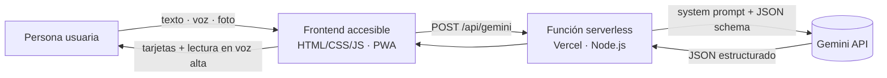

# Ilumina · [NOMBRE DE LA APP]

> **🔗 App demostrable:** **[PENDIENTE: https://TU-PROYECTO.vercel.app](https://TU-PROYECTO.vercel.app)**
> **🎬 Video del pitch (5 min):** [PENDIENTE: liga]
> **🎨 Boceto / diseño:** [PENDIENTE: liga]
> **📘 Documentación completa con IA (Gemini):** [PENDIENTE: liga]

Hackathon Nacional de Innovación con IA · **Ingenio Incluyente** · UVM 2026
**Equipo:** [NOMBRE DEL EQUIPO] · **Campus:** [CAMPUS] · **Reto:** [RETO]

---

## 1. Resumen
[PENDIENTE: qué es la app, a quién ayuda y por qué es innovadora, en 3 o 4 líneas.]

## 2. Problema y usuario objetivo
- **Problema:** [PENDIENTE]
- **Usuario:** [PENDIENTE]
- **Alineación ODS:**
  - **ODS 10 · Reducción de las desigualdades:** [PENDIENTE: cómo reduce la brecha]
  - **ODS 11 · Ciudades y comunidades sostenibles:** [PENDIENTE: cómo hace la ciudad más inclusiva/accesible]

## 3. Funciones principales
| Función | Qué hace | Cómo usa Gemini |
|---|---|---|
| [Función 1] | [PENDIENTE] | [PENDIENTE] |
| [Función 2] | [PENDIENTE] | [PENDIENTE] |
| [Función 3] | [PENDIENTE] | [PENDIENTE] |

## 4. Integración de Gemini (el núcleo de la app)
Gemini no es un chatbot agregado: **es el motor de cada función**.

- **Multimodal:** recibe texto, voz dictada (transcrita en el dispositivo) y fotos tomadas con la cámara.
- **Instrucciones especializadas por función:** cada función tiene su propio *system prompt* en el servidor (`lib/config.js`).
- **Salida estructurada (JSON Schema):** Gemini responde con un formato fijo (`titulo`, `resumen`, `nivel` de urgencia, `puntos` tipo paso/alerta/dato/recurso, `siguiente_accion` y `voz`) que la app convierte en tarjetas accesibles y en audio.
- **Lectura fácil:** cuando la persona lo activa, se agregan instrucciones para que Gemini use frases cortas y lenguaje sencillo.
- **Conversación con contexto:** las preguntas de seguimiento envían el historial reciente.
- **Resiliencia:** reintentos automáticos si Gemini está saturado (429/5xx) y respaldo entre modelos.



## 5. Arquitectura y stack
| Capa | Tecnología |
|---|---|
| Frontend | HTML5, CSS3, JavaScript (ES Modules), PWA instalable (manifest + service worker) |
| Backend | Funciones serverless de Vercel (Node.js 18+), sin dependencias externas |
| IA | Google Gemini API (`generateContent`, salida JSON con `responseSchema`, entrada multimodal) |
| Voz | Web Speech API (dictado y lectura en voz alta en es-MX) |
| Despliegue | Vercel, con despliegue automático desde GitHub |

```
├── api/
│   ├── gemini.js      # POST /api/gemini → llama a Gemini con el prompt de la función
│   └── config.js      # GET  /api/config → configuración pública de la interfaz
├── lib/
│   ├── config.js      # ★ Funciones, prompts y esquema de respuesta (se adapta al reto)
│   ├── gemini.js      # Cliente REST de Gemini con reintentos y respaldo de modelo
│   └── demo.js        # Respuestas de ejemplo si no hay API key
├── public/            # Interfaz (index.html, styles.css, app.js, PWA)
└── scripts/
    ├── dev.js         # Servidor local que imita a Vercel
    └── smoke-test.js  # Prueba automática de los endpoints
```

**Seguridad:** la API key de Gemini **nunca** llega al navegador; vive en una variable de entorno del servidor. Los prompts tampoco se exponen.

## 6. Accesibilidad e inclusión
- Botones grandes (mín. 44 px), navegación con teclado y enlace “Saltar al contenido”.
- **A− / A+**: tamaño de letra ajustable. **Alto contraste** (negro/amarillo).
- **🎤 Dictado por voz** y **🔊 lectura en voz alta** de cada respuesta (es-MX), con opción de lectura automática.
- **Modo “Fácil”**: Gemini responde en lectura fácil.
- Resultados en región `aria-live` para lectores de pantalla; respeta `prefers-reduced-motion`.
- Funciona en cualquier celular desde el navegador y se puede **instalar como app** (PWA), sin tienda de apps.
- [PENDIENTE: accesibilidad específica del reto]

## 7. Manual de usuario
1. Abre **[liga de la app]** en tu celular o computadora. (Opcional: menú del navegador → “Instalar app” / “Agregar a pantalla de inicio”.)
2. Elige lo que necesitas en las tarjetas de arriba.
3. Escribe tu pregunta, toca **🎤 Dictar** para hablar o **📷 Foto o imagen** para mostrar algo.
4. Toca **Preguntar a Gemini**.
5. Lee la respuesta o toca **🔊 Escuchar**. La caja roja te dice qué hacer ahora.
6. ¿Otra duda? Escríbela abajo en “¿Tienes otra duda sobre esto?”.
7. Ajusta letra, contraste, lectura fácil o lectura automática con los botones de arriba.

## 8. Instalación para desarrolladores
```bash
git clone [URL DEL REPO] && cd [CARPETA]
cp .env.example .env        # pega tu GEMINI_API_KEY (Google AI Studio)
npm run dev                 # http://localhost:3000  (sin dependencias que instalar)
npm test                    # prueba automática de los endpoints
```
**Desplegar en Vercel:** importar el repo → agregar `GEMINI_API_KEY` en *Settings → Environment Variables* → Deploy. Cada `git push` vuelve a publicar la app.

## 9. Impacto esperado
[PENDIENTE: a cuántas personas podría ayudar, qué cambia en su vida, cómo se mediría el impacto.]

## 10. Uso de IA en el proceso
- **Gemini** es el motor de la app (sección 4).
- La **documentación** (boceto, documentación funcional y técnica, manual de usuario) se generó con **Gemini** usando el *Prompt de Documentación Básica* oficial del hackathon: [liga al documento].
- [PENDIENTE: otras herramientas de IA usadas en el desarrollo]

## 11. Equipo
| Nombre | Rol |
|---|---|
| [PENDIENTE] | Líder / pitch |
| [PENDIENTE] | Desarrollo |
| [PENDIENTE] | Diseño y documentación |

Licencia MIT.
